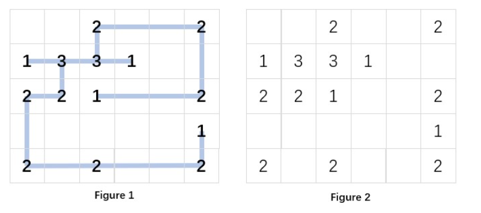

# 8-1 Recover the Design

Score: 20

The garden designer drew a diagram of the fence layout, as shown in Figure 1. Here we assume that the garden is an $(n \times m)$ rectangular space consists of unit squares. All the fences in the diagram are either horizontal or vertical, and are connected together by connectors at certain designated positions. When the workers carried the connectors to the corresponding positions, they found that the design drawing was gone... So now you are facing the situation in Figure 2: several $(k)$-way connectors are placed at some positions. Your job is to restore the diagram, that is, to recover Figure 1 from Figure 2.

Note: The fences cannot be bent, nor can they cross each other without a connector. The corners can only be formed through connectors.

## Input Specification

Each input file contains one test case. For each case, the first line gives two positive integers: $(n)$ and $(m)$ ($(1 \leq n,m \leq 50)$), which are the numbers of rows and columns in the garden, respectively.

Then $(n)$ lines follow, each contains $(m)$ numbers, which are separated by spaces. Each number is either a positive $(k)$ ($(1 \leq k \leq 4)$) which is the degree of the connector, or 0, meaning that there is no connector at this position.

## Output Specification

For each case, if there is no solution, simply print in a line `No Solution`. Else scan the garden row by row, each from left to right, to output the status of each connector in a line. The output format is the following:

```
row col up down left right
```

where `row` and `col` are the numbers of the row and the column of the connector's position (row numbers are counted top-down from 1, and column numbers are counted left to right from 1); the status of the 4 directions `up`, `down`, `left` and `right` are either 1 or 0, corresponding to whether or not a piece of fence is connected in that direction, respectively.

On the other hand, the solution may not be unique. Output one will do.

The numbers in a line must be separated by a space, and there must be no extra space at the beginning or the end of the line.

## Grading Policy

- **Programming:** Write the program (10 pts.) with sufficient comments.
- **Testing:** Provide a set of test cases to fill in a test report (3 pts.). Write analysis and comments (3 pts.).
- **Documentation:** Chapter 1 (1 pt.), Chapter 2 (2 pts.), and finally a complete report (1 point for overall style of documentation).

--- 
当前文件夹基本结构如下

```
project3
├── data
|   └── recover_the_design_the_large_dataset
|   └── Hashi_Puzzles
|                ├── 100
|                └── 200
|                └── ...
├── figure
│   └── figure1.png
├── src
│   ├── recover_the_design.c
│   ├── recover_the_design.h
│   └── testbench_time.c
└── README.md
```
其中利用`recover_the_design.c`和`recover_the_design.h`实现了恢复栅栏结构的功能，利用`testbench_time.c`对恢复栅栏结构的功能进行测试。

简单测试可以直接用`recover_the_design_the_large_dataset`中的数据手动操作使用。

数据集已利用AI修改了第一组数据，目前`testbench_time.c`中设置了`TEST_DIR`为`../data/Hashi_Puzzles/100`，可以直接运行测试输出为csv文件，后续绘制图像可以直接使用