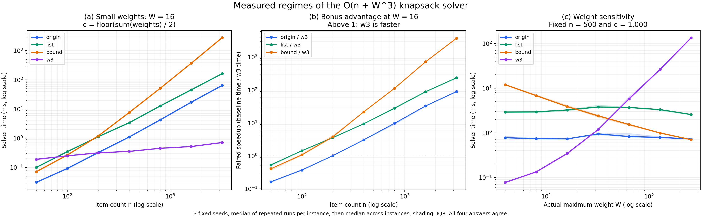

# Bonus 小重量优势实验

## 方法

使用未修改的四个算法和现有 Windows 隔离 benchmark；编译采用 `gcc -std=c11 -O2`。
计时只包含求解函数（含其内部预处理、分配与释放），不包含读取和进程启动。
价值独立均匀取自 1..1000，不随 W 改变；重量为 1..W 的均匀样本，首件强制达到 W。
三个固定种子为 20261121、20261122、20261123。同一种子使用共同随机数；n 实验取同一序列前缀。
先对同实例的重复计时取中位数，再对三个实例取中位数；阴影表示实例中位数的四分位范围。
加速比先在同一实例配对计算，再取中位数。

- n 实验：W=16，n=50/100/200/400/800/1600/3200，c=floor(总重量/2)。
- W 实验：n=500、c=1000，W=4/8/16/32/64/128/256。
- 单次超时 15 秒、内存限制 1 GiB，全部实例都不能将所有物品装入。
- 每实例每算法重复 3 次。
- 原始计时记录 504 条，全部 status=ok、agreement=match。

## 小重量结果

W=16、n=3200 时：

| 算法 | 中位耗时（ms） | 相对 w3 的配对加速比 |
| --- | ---: | ---: |
| origin | 64.509300 | 89.62× |
| list | 163.707500 | 236.30× |
| bound | 2784.813000 | 3750.12× |
| w3 | 0.715600 | 1.00× |

w3 在所有三个实例中均快于该基线的最小受测 n：

- origin: 400（仅针对本次受测规模，不代表普遍阈值）。
- list: 100（仅针对本次受测规模，不代表普遍阈值）。
- bound: 100（仅针对本次受测规模，不代表普遍阈值）。

## 重量敏感性结果

| W | origin（ms） | list（ms） | bound（ms） | w3（ms） |
| ---: | ---: | ---: | ---: | ---: |
| 4 | 0.776600 | 2.918400 | 11.974700 | 0.077500 |
| 8 | 0.741900 | 2.946600 | 6.824600 | 0.133500 |
| 16 | 0.731300 | 3.255200 | 3.878100 | 0.344500 |
| 32 | 0.949100 | 3.791200 | 2.407800 | 1.180600 |
| 64 | 0.825000 | 3.699600 | 1.535800 | 5.775000 |
| 128 | 0.791400 | 3.314900 | 0.992800 | 26.236400 |
| 256 | 0.727600 | 2.572900 | 0.705000 | 133.394100 |

## 解释和适用范围

w3 每侧修正数组长约 2W²，并对每种实际出现的重量执行一次结构化卷积。
小 n、大 W 时，这一状态范围远大于实际容量，BFPRT、SMAWK 递归及其内存分配常数也较高。
固定小 W、增大 n 时，修正 DP 的大小不随 n 增长，前处理仍为线性；当容量随 n 增长时，
普通 DP 的 n*c 开销持续增加。list 的状态规模与数据分布有关；当前 bound 还包含选择排序和逐状态扫描。
因此本实验展示的是当前四种实现的小重量优势区间，不能说明所有数据上 w3 都更快，
也不能把 bound 的全部差距归因于邻近性技术：其实现本身仍有额外开销。
W 对照中 n 和 c 保持不变，但重量分布仍会改变可达状态和剪枝效果，因此曲线不是单独的复杂度证明。
本次未优化算法实现、未排除正常的慢样本，也未把失败或超时当作完成计时。

## 复现

```powershell
gcc -std=c11 -O2 -Wall -Wextra src/testbench.c -o src/testbench.exe
python src/experiment_bonus.py
# 只用已保存的 CSV 重画：
python src/experiment_bonus.py --plot-only
```



原始数据：`bonus_advantage_n.csv`、`bonus_advantage_w.csv`；输入保存在 `bonus_advantage_inputs/`。
汇总与配对加速比：`../plots/bonus_advantage_summary.csv`、`../plots/bonus_advantage_speedups.csv`。

## 初次资源限制试验

初次使用 512 MiB 限制，共 252 条记录，其中 3 条失败。
失败均为 n=3200 的同一实例的 list 工作进程（3 次），与内存不足相符。
原始结果保留为 `bonus_advantage_n_initial_512mb.csv`。随后对全部算法统一使用 1 GiB 完整重跑，
正文与图表只使用这次统一配置的结果；没有将初次失败当作计时或加速比。

## 已有 KPLIB 结果的解释

用户原有 `all_n50_R1000.csv` 中，n=50，实际 W 约 1000。

| 算法 | 平均耗时（ms） |
| --- | ---: |
| origin | 0.985455 |
| list | 0.162547 |
| bound | 0.109837 |
| w3 | 390.141626 |

此时每侧修正数组约 200 万项，而原容量中位数仅 12340；当前实现没有
按前缀可删除总重量进一步收紧这个保守窗口。对实际出现的每种重量都扫描该窗口，
再叠加 SMAWK 与分配开销，因此显著慢于原有 DP。O(n+W³) 是参数化的渐近优势，
不能单凭公式认为它在 n 小、W 大时更优。
